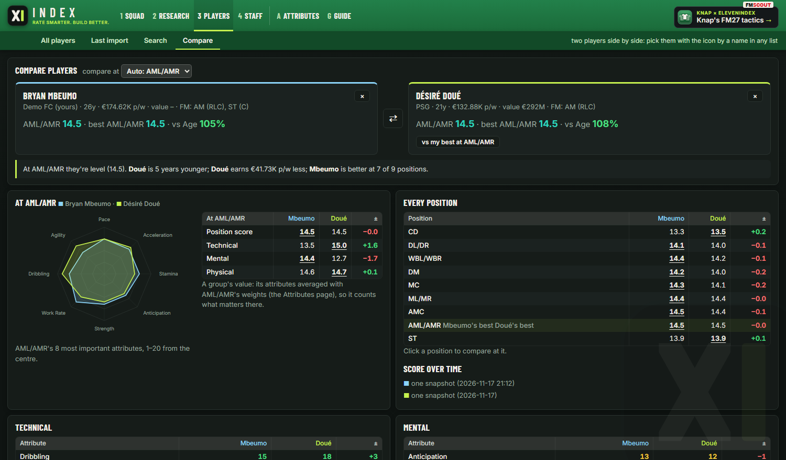
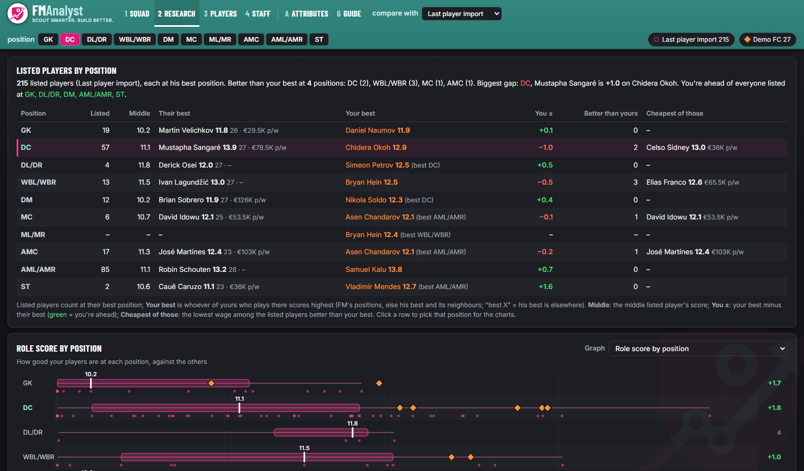
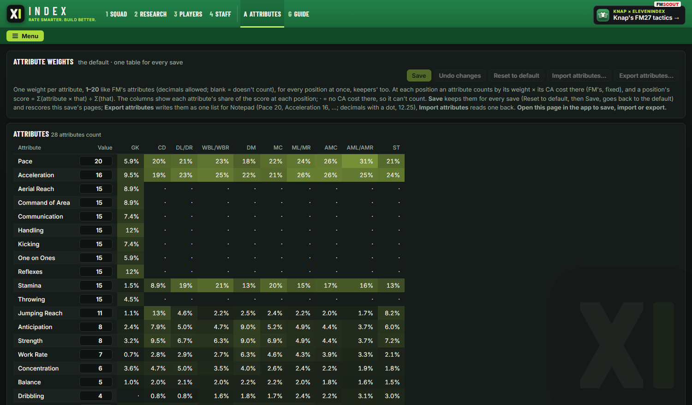

<p align="center">
  
</p>

<p align="center">
  <b>ElevenIndex</b> · Squad &amp; staff scoring for Football Manager 27<br>
  Every player you look at, scored at every position: plan your lineup, find better signings,<br>
  hire better staff and follow how your players develop.
</p>

<p align="center">
  <a href="https://github.com/angelkirchev/ElevenIndex/releases/latest/download/ElevenIndex.exe"></a>
</p>

<p align="center">
  <a href="https://github.com/angelkirchev/ElevenIndex/releases/latest"></a>
  
  
  
</p>

<p align="center">
  Press <b>F8</b> on a list in FM, choose <b>Menu → Import file…</b> in the app, and every page updates.<br>
  No typing, no screenshots. Everything is explained in the app's own <b>Guide</b> (key <b>G</b>).
</p>

---

<p align="center">
  
  <br><sub><b>Lineup</b>: your best eleven for any formation; click a position for everyone who plays it and who on your lists would beat them</sub>
</p>

<table>
  <tr>
    <td width="50%" valign="top"><br><sub><b>Formations</b>: 20 shapes ranked by how well your squad fits them, each with its numbers</sub></td>
    <td width="50%" valign="top"><br><sub><b>Profiles</b>: what he's good for, strengths, weaknesses, what to train first</sub></td>
  </tr>
  <tr>
    <td valign="top"><br><sub><b>Compare</b>: two players side by side, at any position</sub></td>
    <td valign="top"><br><sub><b>Research</b>: your best at each position against everyone you've scouted, or your squad by age</sub></td>
  </tr>
  <tr>
    <td valign="top"><br><sub><b>Analysis</b>: your team position by position, ranked by score or any attribute</sub></td>
    <td valign="top"><br><sub><b>Development</b>: how your players changed between two squad exports</sub></td>
  </tr>
  <tr>
    <td valign="top"><br><sub><b>Player search</b>: the minimums to type into FM's search to beat your players</sub></td>
    <td valign="top"><br><sub><b>Staff</b>: every staff member scored for every job</sub></td>
  </tr>
  <tr>
    <td colspan="2" align="center" valign="top"><br><sub><b>Attributes</b>: one weight per attribute (1–20) for every save, to tune the scoring your way</sub></td>
  </tr>
</table>

<p align="center"><sub>Screens from a demo save: your club and players will differ.</sub></p>

---

## Get started

About 15 minutes, once. Nothing here changes your FM saves. Quit FM before steps 1–3.

> **FM's game folder:** in Steam, right-click **Football Manager 27** → **Manage → Browse local files**.
> It's the folder with **`fm.exe`** in it.

### 1 · Install BepInEx 6 (the mod loader)

BepInEx lets FM load the small export mod in step 2. You need the **Unity IL2CPP, Windows x64** build of BepInEx 6.

1. Open **[BepInEx's builds page](https://builds.bepinex.dev/projects/bepinex_be)** and download the newest
   **`BepInEx-Unity.IL2CPP-win-x64-6.0.0-be.…zip`**
   (currently [`BepInEx-Unity.IL2CPP-win-x64-6.0.0-be.793+dbc82f0.zip`](https://builds.bepinex.dev/projects/bepinex_be/793/BepInEx-Unity.IL2CPP-win-x64-6.0.0-be.793%2Bdbc82f0.zip)).
   Not the *Unity.Mono* or *NET* builds: FM needs **Unity.IL2CPP** and **win-x64**.
2. Right-click the zip → **Extract All…** and extract it **into FM's game folder**, so the BepInEx files sit next to
   `fm.exe`:

   ```
   Football Manager 27\          ← FM's game folder
   ├── BepInEx\
   ├── dotnet\
   ├── doorstop_config.ini
   ├── winhttp.dll
   └── fm.exe
   ```
3. Start FM once and wait: the first start with BepInEx takes a few minutes (a black console window may open). When the
   main menu shows, quit FM. `BepInEx` now has `plugins`, `config` and a `LogOutput.log`: BepInEx works.

### 2 · Install FM27 Exporter (the F8 export)

1. Download **`FM27Exporter-…-plugin-only.zip`** from
   **[FM27 Exporter's releases](https://github.com/v1adicke/fm27-exporter/releases)** (a free mod, not made by Sports
   Interactive or this project).
2. Extract it and copy its **`BepInEx`** folder into FM's game folder, onto the one from step 1 (Windows merges them).
   The exporter ends up in `BepInEx\plugins\FM27Exporter`.
3. Start FM: **F8** now exports the list under the mouse to `Documents\Sports Interactive\Football Manager 27\exports`.

<details>
<summary>Shortcut: steps 1 and 2 in one go</summary>

FM27 Exporter's full **`FM27Exporter-….zip`** (without *plugin-only*) includes BepInEx 6: extract it and copy
everything in its **`payload`** folder into FM's game folder. Then start FM and wait the few minutes.

</details>

| Key in FM | What it does |
|---|---|
| **F8** | exports the list under the mouse (every row) |
| **Ctrl + F8** | adds all attribute columns to the current view |

### 3 · Add the views and search filters

1. Download **[`ElevenIndex-FM27-views-and-filters.zip`](https://github.com/angelkirchev/ElevenIndex/releases/latest/download/ElevenIndex-FM27-views-and-filters.zip)**.
2. Right-click it → **Extract All…** and extract it into **`Documents\Sports Interactive\Football Manager 27`**
   (inside OneDrive if your Documents are there). It already has FM's folders, so everything lands in place:

   ```
   Football Manager 27\          ← in Documents\Sports Interactive
   ├── views\                    4 views
   ├── player search filters\    GK, FB, WB, DM, MC, MLR, AMC, AMLR, ST
   └── staff search filters\     one per job: Assistant Manager … U18 Manager
   ```
   If Windows asks about replacing files of yours, choose **Skip**.
3. In FM, pick the view that fits each screen (the view menu at the top of the list):

   | Screen in FM | View | Filter |
   |---|---|---|
   | Your squad | **`Squad - All Players View`** (the one to export) | |
   | Player search, outfield | **`Search - Outfield Players View`** | the position: FB, WB, DM, MC, MLR, AMC, AMLR, ST |
   | Player search, goalkeepers | **`Search - Goalkeepers View`** | GK |
   | Staff search | **`Search - Staff View`** | the job: Assistant Manager, Coach, Director of Football… |

### 4 · Start ElevenIndex

1. Download **[`ElevenIndex.exe`](https://github.com/angelkirchev/ElevenIndex/releases/latest/download/ElevenIndex.exe)**,
   put it somewhere permanent (e.g. **Documents**) and double-click it. If Windows says *Windows protected your PC*,
   click **More info → Run anyway** (it asks once).
2. The first time it asks for the **club you manage** (exactly as FM writes it, e.g. "Man Utd"), the **currency** FM
   shows wages in, and **FM27 Exporter's folder** (usually found for you). Tick **Desktop shortcut** if you want one,
   then click **Start**.

<details>
<summary>Or run it from source, with Python</summary>

Install [Python](https://www.python.org/downloads/) 3.11+ (tick **Add python.exe to PATH**), download this project
(green **Code** button → **Download ZIP**), extract it, and double-click **`ElevenIndex.bat`**. The first time it installs
pywebview, which the app needs.

</details>

### 5 · Import your squad

In FM, open your squad screen with **`Squad - All Players View`**, point at the list and press **F8**. In the app,
open **Menu → Import file…** (bottom right) and choose the export. Done: your Lineup and Formations are ready.

From then on, press **F8** on any player search, shortlist or staff search and import it the same way. Everything else
is explained in the app's **Guide** (key **G**).


---

<details>
<summary><b>Good to know</b></summary>

- **Your data** is in `Documents\ElevenIndex`. To update the app, replace `ElevenIndex.exe` with the newest one: your
  data stays.
- **Several saves:** **Menu → Saves** switches between them, starts a new one or deletes one (restorable there for 14 days).
- **Players left out of an import** have too many unscouted attributes to score: scout them more and export again.
- **"The export has no attributes":** press **Ctrl + F8** on the list in FM, then **F8** again.
- **F8 does nothing:** check that FM's game folder has `BepInEx`, `winhttp.dll` and `BepInEx\plugins\FM27Exporter`;
  `BepInEx\LogOutput.log` says whether the exporter loaded.
- **The window stays blank:** install Microsoft's **WebView2 Evergreen Runtime** from the
  [WebView2 page](https://developer.microsoft.com/microsoft-edge/webview2/).
- **Something else:** `app.log` in your data folder says what happened.

</details>

<details>
<summary><b>Where the scores come from</b></summary>

A position score is the weighted average of a player's attributes on FM's 1–20 scale. Each attribute has one weight
(1–20), multiplied at each position by FM's own CA cost there. The default weights come from **harvestgreen22**'s FM27
attribute test, measuring how much each attribute wins matches
([sortitoutsi](https://sortitoutsi.net/content/78219/fm27-attribute-test-tactical-understanding-training-system-preset-tactics-ai-reverse-engineering-engine-for-test#comment_910309),
tabled by squirrel_plays on [FM-Arena](https://fm-arena.com/threads/player-attributes.59/)), and the CA costs from
FM Scout's table. Change them on the **Attributes** page: one table for every save.

</details>

---

<p align="center">
  <sub>Imports use <a href="https://github.com/v1adicke/fm27-exporter">FM27 Exporter</a> · MIT licence, see <a href="LICENSE">LICENSE</a> ·
  not affiliated with Sports Interactive or SEGA</sub>
</p>
