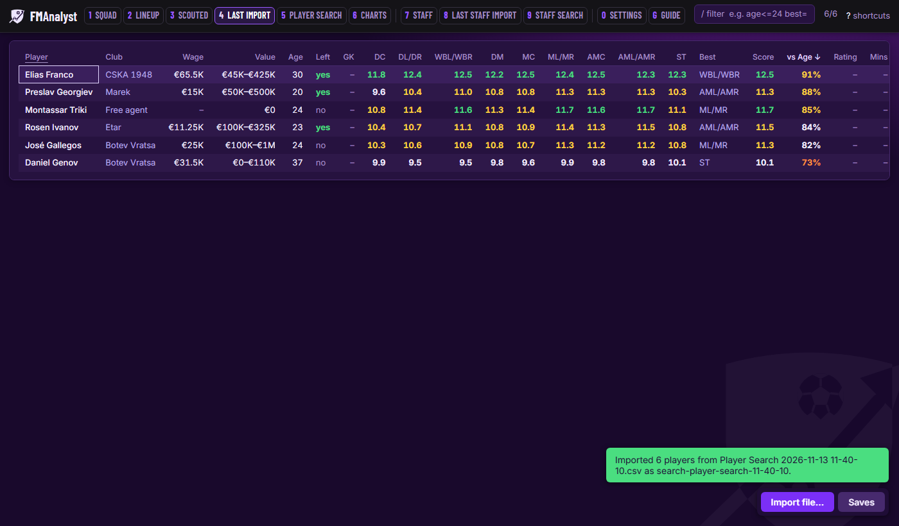
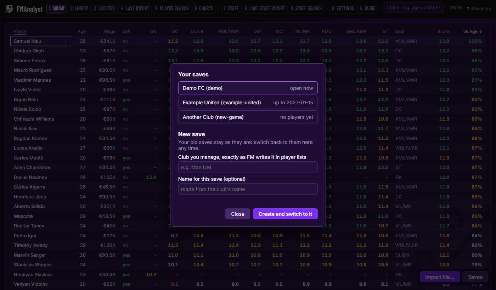
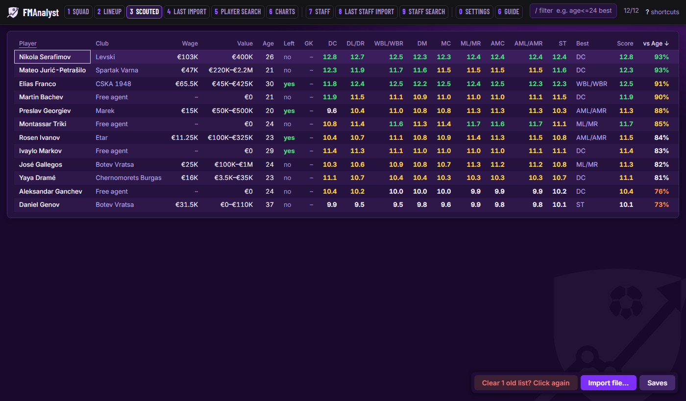

**Squad, player and staff analysis for Football Manager 2027.** A Windows app that scores every player you look at
at each position, so you can compare your squad, transfer targets and staff at a glance, and follow how players
develop over the seasons.

Press **F8** on a list in FM, click **Import file…** in the app, and your pages update. No typing, no screenshots.

**[⬇ Download FMAnalyst.exe](https://github.com/angelkirchev/FMAnalyst/releases/latest/download/FMAnalyst.exe)** · Windows 10/11 · free

Also for FM27, usable on their own: **[views](https://github.com/angelkirchev/FMAnalyst/tree/main/views)** ·
**[player search filters](https://github.com/angelkirchev/FMAnalyst/tree/main/player%20search%20filters)** ·
**[staff search filters](https://github.com/angelkirchev/FMAnalyst/tree/main/staff%20search%20filters)** ·
**[training schedules](https://github.com/angelkirchev/FMAnalyst/releases/latest/download/fm27-training-schedules.zip)**
(all the views and filters in one [ZIP](https://github.com/angelkirchev/FMAnalyst/archive/refs/heads/main.zip))

- [What it looks like](#what-it-looks-like)
- [Installation](#installation)
- [Using it](#using-it)
- [FAQ](#faq)
- [How it works](#how-it-works)

---

## What it looks like

*From a demo save. Your own club and players will differ.*

**Your squad**, scored at FM's 10 position groups. **Best** is each player's strongest position, **vs Age** how they
compare with what's typical for their age. Green is strong, orange weak.


**Right after an import**: the **Last import** page shows only the list you just imported, and a message confirms it.



**Player search**: your best players per position, and the minimums (**Search ≥**) to type into FM's player search to find
better ones.


**Saves**: switch between saves or start a new one. **Clear old lists** tidies up **Scouted**, the players you've looked at.





**Staff**, scored for every job: manager, each coaching group, scout, physio and more.


---

## Installation

About 15 minutes, once. Nothing here changes your FM save games.

### 1. Install BepInEx and FM27 Exporter

FM27 Exporter is a free mod that adds the **F8** export to FM (it isn't made by Sports Interactive or by this project).
It's a **BepInEx plugin**, so it needs two things in FM's game folder:

- **BepInEx 6** (the IL2CPP build), the mod loader that runs plugins in FM
- **FM27 Exporter** itself, in BepInEx's **`plugins`** folder

To find FM's game folder: in Steam, right-click **Football Manager 27** → **Manage → Browse local files**.
Quit FM before copying anything into it.

**No BepInEx yet (most people):** download **`FM27Exporter-1.0.0.zip`** from
[FM27 Exporter's releases](https://github.com/v1adicke/fm27-exporter/releases) (also on
[fmscout](https://www.fmscout.com/a-fm27-exporter.html)) and extract it (right-click → **Extract All…**). It includes
BepInEx 6. Copy everything in its **`payload`** folder into FM's game folder: that installs BepInEx and puts the
exporter in `BepInEx\plugins` in one go.

**Already have BepInEx 6:** download **`FM27Exporter-1.0.0-plugin-only.zip`** from the same page instead, and copy
the exporter into your **`BepInEx\plugins`** folder.

Then start FM. The first start with BepInEx takes a few minutes. A Windows warning about `winhttp.dll` is fine: it's
part of BepInEx. It worked if FM's game folder now has a `BepInEx\plugins` folder with the exporter in it, and
`BepInEx\LogOutput.log` mentions FM27 Exporter.

| Key in FM | What it does |
|---|---|
| **F8** | Exports the list under the mouse (every row, not only those on screen) |
| **Ctrl + F8** | Adds all 47 attribute columns to the current view |

### 2. Get the app

**[Download FMAnalyst.exe](https://github.com/angelkirchev/FMAnalyst/releases/latest/download/FMAnalyst.exe)**,
put it somewhere permanent (e.g. **Documents**) and double-click it. If Windows says **Windows protected your PC**,
click **More info → Run anyway** (it only asks once).

<details>
<summary>Or run it from source, with Python</summary>

Install [Python](https://www.python.org/downloads/) 3.11+ (tick **Add python.exe to PATH**), download this project
(green **Code** button → **Download ZIP**), extract it to `Documents\FMAnalyst-main`, and double-click **`FMAnalyst.bat`**.
The first time, it installs pywebview, which the app needs.

</details>

### 3. Set up your save

The first time, the app asks for:

- **Club you manage**, exactly as FM writes it in its lists ("Man Utd", not "Manchester United")
- **Currency** FM shows wages in
- **FM27 Exporter's folder**: usually found for you
- **Desktop shortcut**: tick to get one

Click **Start**.

### 4. Add the views to FM

The views give FM's lists the right columns.

1. **[Download the project ZIP](https://github.com/angelkirchev/FMAnalyst/archive/refs/heads/main.zip)** and extract it.
   You need its **`views`** folder (and, if you like, `player search filters` and `staff search filters`).
2. Quit FM, then open `Documents\Sports Interactive\Football Manager 27` (inside OneDrive if your Documents are there).
3. Copy the files from the project's `views` folder into FM's `views` folder. Copy the files, not the folder, and
   choose **Skip** if Windows asks about replacing your own views.
4. Start FM. On your **squad** screen pick the **`attribs_outfield`** view; on **player search**, **`player_search_outfield`**;
   on **staff search**, **`staff_everything`**.
5. On each of the two player views, point at the list and press **Ctrl + F8** once, so every attribute shows,
   goalkeeping ones included.

### 5. Import your squad

On your squad screen, point at the list and press **F8**. In the app, click **Import file…** and choose the export
(e.g. `First Team 2026-11-13 09-15-57.csv`). Done: press **1** to see your squad.

---

## Using it

**To add players:** press **F8** on any list in FM, then **Import file…** in the app.

| You export | It becomes |
|---|---|
| Your squad (file starts `First Team` or `Squad`) | Your squad. Players missing from a newer squad export count as gone. |
| A search or shortlist | A list of its own, shown on **Last import** (key 4) and kept on **Scouted** (key 3) |
| Staff from a staff search (the `staff_everything` view) | Staff, shown on **Last staff import** (key 8) |
| A whole division, with Division, Minutes and Average Rating columns | Adds the division and the rating charts to **Charts** (key 6). Rename the file first, e.g. `league-one.csv`. |

**The pages:** press the number keys to switch, **?** for all shortcuts. Click a column to sort, double-click a player
for their history, and type in the filter box, e.g. `age<=21 best=DC`.

| Key | Page | Key | Page |
|---|---|---|---|
| 1 | Squad: your players | 6 | Charts: your squad against your last import |
| 2 | Lineup: your formation, starter / backup / third | 7 | Staff: every staff member you've imported |
| 3 | Scouted: everyone else you've looked at | 8 | Last staff import |
| 4 | Last import: your latest import | 9 | Staff search: the best staff you've imported, and what to search for |
| 5 | Player search: what to search for to beat your players | 0 | Settings |
|   |   | g | Guide: how to use each page |

**More than one save:** click **Saves** to switch, or to start a save for a new game or club.

**Tidying up:** **Clear old lists** on Scouted and Staff (click twice) moves old searches to an archive. It keeps
your squad and your latest list, and nothing is deleted.

**Your formation:** the Lineup page uses one row per position until you set a formation. Add it to your save's
`save.toml` (in your data folder, see [FAQ](#faq)), one line per slot; `pos` is one of GK, DC, DL/DR, WBL/WBR, DM, MC,
ML/MR, AMC, AML/AMR, ST, and `left = true` means left-footed only:

```toml
grid = [
  { label = "GK", pos = "GK" },
  { label = "D R", pos = "DL/DR" }, { label = "D C", pos = "DC" },
  { label = "D C left", pos = "DC", left = true }, { label = "D L", pos = "DL/DR", left = true },
  { label = "DM", pos = "DM" }, { label = "DM", pos = "DM" },
  { label = "AM R", pos = "AML/AMR" }, { label = "AM C", pos = "AMC" }, { label = "AM L", pos = "AML/AMR", left = true },
  { label = "ST", pos = "ST" },
]
```

---

## FAQ

**Where is my data?** In `Documents\FMAnalyst`: your settings (`config.toml`), saves and pages. Replacing the
`.exe` with a newer one keeps it all. (Run from source, it's in the project's folder.)

**How do I update the app?** Download the latest `FMAnalyst.exe` and replace the old one.

**Some players were left out of an import.** Too many of their attributes are unscouted (FM shows `-`) to score them.
Scout them more, then export again.

**The import says the export has no attributes.** The view had no attribute columns. Press **Ctrl + F8** on the list,
then **F8** again.

**F8 does nothing in FM.** Check step 1: FM's game folder needs **BepInEx 6** (a `BepInEx` folder and `winhttp.dll`),
and FM27 Exporter must be in **`BepInEx\plugins`**. `BepInEx\LogOutput.log` shows whether the plugin loaded.

**Import file… opens the wrong folder.** Open `config.toml` in your data folder with Notepad and set
`exports_dir = "D:/Documents/Sports Interactive/Football Manager 27/exports"` to your exports folder.

**The window stays blank.** The app needs Microsoft's WebView2, built into Windows 11 and up-to-date Windows 10.
Install the **Evergreen Runtime** from Microsoft's [WebView2 page](https://developer.microsoft.com/microsoft-edge/webview2/).

**What does Charts compare?** Your squad (orange) with the players in **compare with** at the top: your **Last
import** (the default), **All imported players**, or a whole division if you've imported one. The two average-rating
charts need a division export with Minutes and Average Rating columns.

**What does Staff search show?** For each job, the best staff you've imported from staff searches and the minimums
(FM's words) to set in FM's staff search to find staff at least that good.

**I imported the wrong file.** Close the app, delete its files in your data folder's `saves\<your save>\obs` (their
names start with the export's date), and start the app again.

**Something else went wrong.** `app.log` in your data folder says what happened.

**Can I use just the views, search filters or training schedules?** Yes, without the app:

- **Views and search filters:** browse the [views](https://github.com/angelkirchev/FMAnalyst/tree/main/views),
  [player search filters](https://github.com/angelkirchev/FMAnalyst/tree/main/player%20search%20filters) and
  [staff search filters](https://github.com/angelkirchev/FMAnalyst/tree/main/staff%20search%20filters), or get them all in
  the [project ZIP](https://github.com/angelkirchev/FMAnalyst/archive/refs/heads/main.zip). Copy the files into FM's folders
  of the same names, as in step 4 (create a folder if FM doesn't have it yet). They appear under their file names in
  FM's view options and search screens.
- **Training schedules:** [download the ZIP](https://github.com/angelkirchev/FMAnalyst/releases/latest/download/fm27-training-schedules.zip)
  and follow `How to install.txt` inside. The schedules are also in the
  [schedules](https://github.com/angelkirchev/FMAnalyst/tree/main/schedules) folder.

---

## How it works

Each position has a list of attributes that matter there, each with a weight. A player's position score is the
weighted average of those attributes, on FM's 1–20 scale; unscouted attributes are skipped as long as 85% of the
weight is known. **vs Age** compares a player's best score with what's typical at their age: 100% means on track to be a
high-end Championship or low-end Premier League player in their prime.

The weights come from FM27 research by the community:

- **harvestgreen22**'s attribute test, measuring how much each attribute wins matches
  ([sortitoutsi](https://sortitoutsi.net/content/78219/fm27-attribute-test-tactical-understanding-training-system-preset-tactics-ai-reverse-engineering-engine-for-test);
  tabled by squirrel_plays on [FM-Arena](https://fm-arena.com/threads/player-attributes.59/)). Pace, Acceleration and
  Stamina matter most.
- FM's own **CA costs**: which attributes FM counts at each position.
- **Purity**'s test of attribute importance by position
  ([FM-Arena](https://fm-arena.com/threads/attribute-importance-by-position-in-fm27-a-test-on-my-own-tactic.125/)),
  as an alternative set to compare with.

Imports use [FM27 Exporter](https://github.com/v1adicke/fm27-exporter). MIT licence, see [LICENSE](LICENSE).
Not affiliated with Sports Interactive or SEGA.
