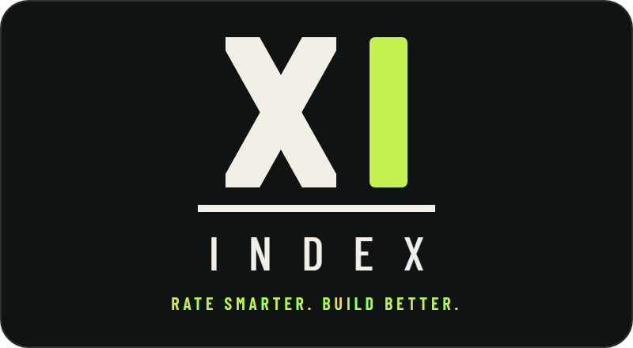
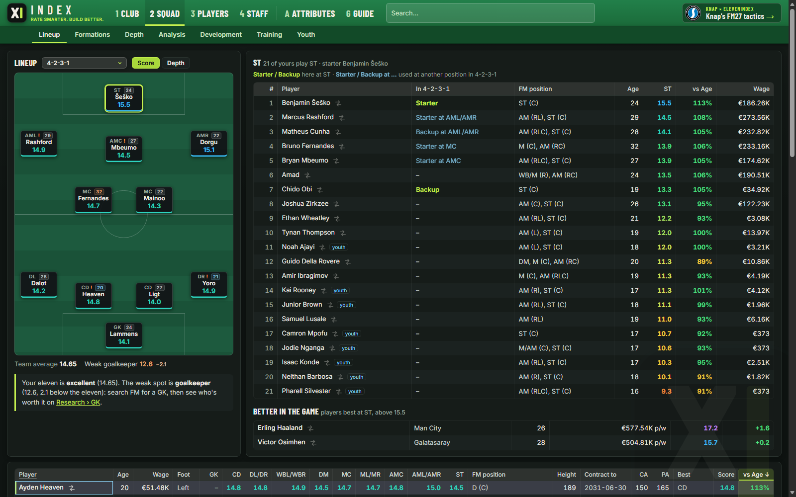
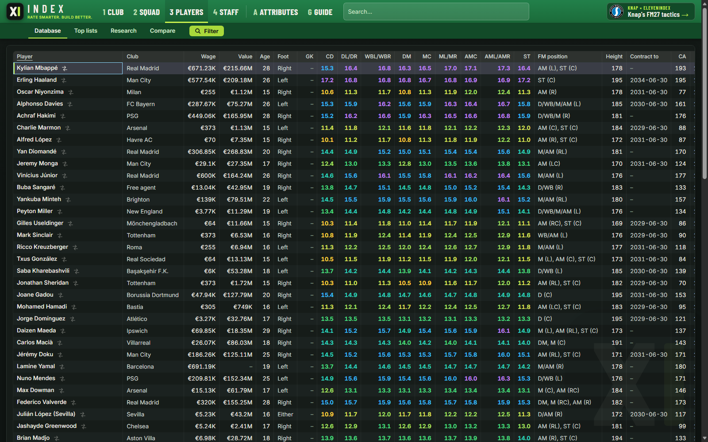
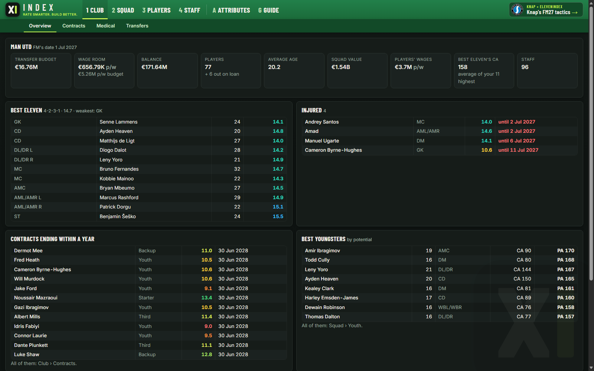
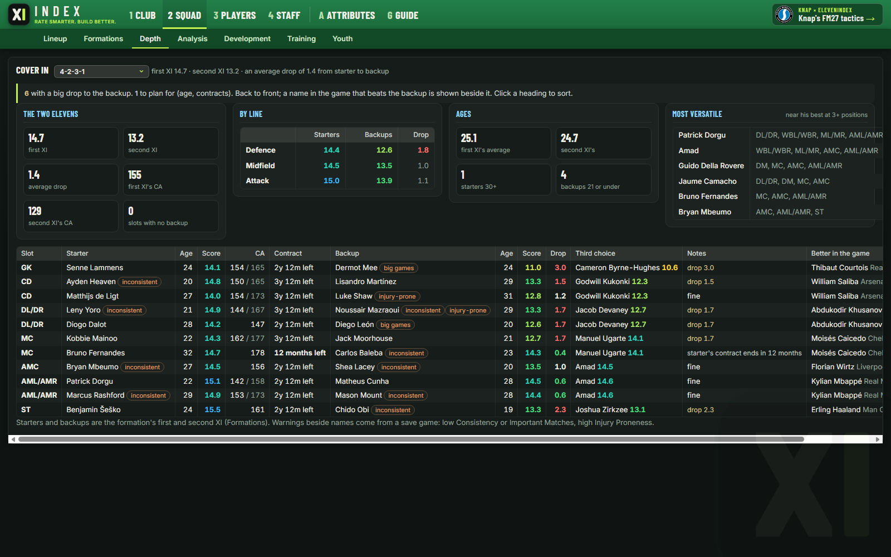
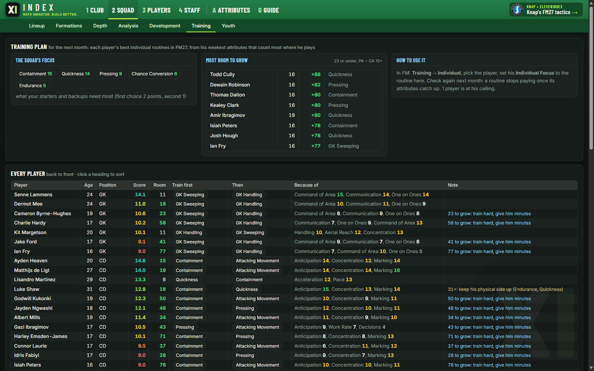
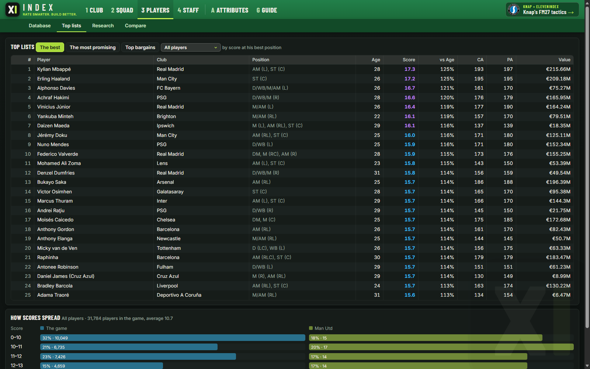

  

  <b>ElevenIndex</b> · Squad &amp; staff scoring for Football Manager 27 
  Reads your FM27 save game and scores every player at every position and every staff member for every job: 
  plan your lineup, find better signings, hire better staff, train and develop your players.

  

  
  
  
  

  Save your game in FM, then <b>Menu → Read save game…</b> in the app (or drop the <b>.fm</b> file on its window). 
  No mods, no exports, no typing. FM's save is only ever read, never changed.

---

  
   <b>Lineup</b>: your best eleven for any formation; click a position for everyone who plays it and who in the game would beat them

<table>
  <tr>
    <td width="50%" valign="top"> <b>Profiles</b>: personal details, contract, attributes like FM's, a scout report, CA/PA, personality and hidden attributes</td>
    <td width="50%" valign="top"> <b>Players database</b>: every player in the game, with a Filter for anything: position, contract, ability, attributes, personality</td>
  </tr>
  <tr>
    <td valign="top"> <b>Club</b>: budgets, squad, best eleven, injuries, contracts ending, youngsters; plus Contracts, Medical and Transfers</td>
    <td valign="top"> <b>Formations</b>: 26 shapes ranked by how well your squad fits them, with a scout's view of the good and the bad</td>
  </tr>
  <tr>
    <td valign="top"> <b>Depth</b>: starter, backup and third choice at every position, and who in the game would do better</td>
    <td valign="top"> <b>Training</b>: each player's next individual training routine in FM, from his weak points where he plays</td>
  </tr>
  <tr>
    <td valign="top"> <b>Development</b>: how your players changed between checkpoints (31 Dec, 30 Jun, now)</td>
    <td valign="top"> <b>Top lists</b>: the best, the most promising and the bargains in the game, by position</td>
  </tr>
  <tr>
    <td colspan="2" valign="top"> <b>Staff</b>: your staff, one person per job, against every staff member in the game, with a Staff plan</td>
  </tr>
</table>

Screens from a test save.

---

## Get started

1. Download **ElevenIndex.exe** from **[elevenindex.pages.dev](https://elevenindex.pages.dev)**, put it somewhere permanent
   (e.g. **Documents**) and double-click it. If Windows says *Windows protected your PC*, click **More info → Run anyway**.
2. The first time it asks for the **club you manage** and the **currency** FM shows wages in, then **Start**.
3. In FM, **save your game**. In the app, **Menu → Read save game…** (or drop the `.fm` file on the window). About a minute
   later every page is up to date. **Auto-read** (on by default) reads each new save by itself.

Everything else is explained in the app's **Guide** (key **G**).

Run it from source, with Python

Python 3.14+ (it reads the save with the standard library's `compression.zstd`). Double-click **`ElevenIndex.bat`**:
the first time it installs pywebview, which the window needs. `python build.py` builds the .exe (PyInstaller).

<b>Good to know</b>

- **Your data** is in `Documents\ElevenIndex`. To update, replace `ElevenIndex.exe` with the newest one: your data stays.
- **Another club:** **Menu → Game profiles… → New** (one game profile per club you manage).
- **The window stays blank:** install Microsoft's **WebView2 Evergreen Runtime**
  ([WebView2 page](https://developer.microsoft.com/microsoft-edge/webview2/)).
- **Something else:** `app.log` in your data folder says what happened.

<b>Where the scores come from</b>

A position score is the weighted average of a player's attributes on FM's 1–20 scale. Each attribute has one weight
(1–20), multiplied at each position by FM's own CA cost there. The default weights come from **harvestgreen22**'s FM27
attribute test, measuring how much each attribute wins matches
([sortitoutsi](https://sortitoutsi.net/content/78219/fm27-attribute-test-tactical-understanding-training-system-preset-tactics-ai-reverse-engineering-engine-for-test#comment_910309),
tabled by squirrel_plays on [FM-Arena](https://fm-arena.com/threads/player-attributes.59/)). Change them on the
**Attributes** page. The save game reader (`fm_save.py`) is our own, written from the file itself.

---

  © 2026 Angel Kirchev, all rights reserved: free to download and use, not to copy, modify or republish (see <a href="LICENSE">LICENSE</a>) ·
  not affiliated with Sports Interactive or SEGA

