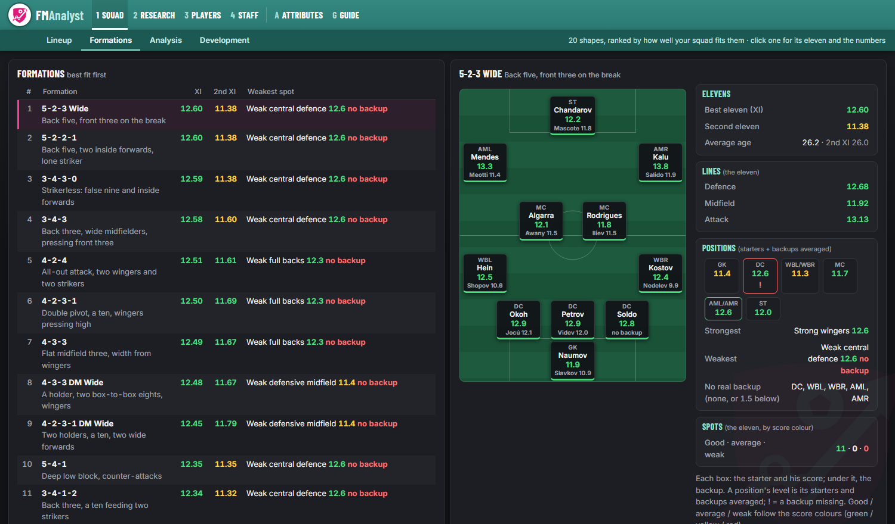
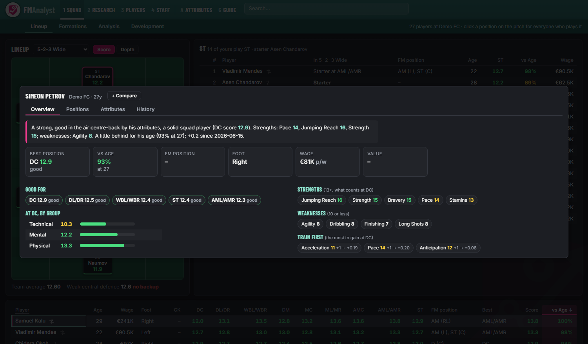
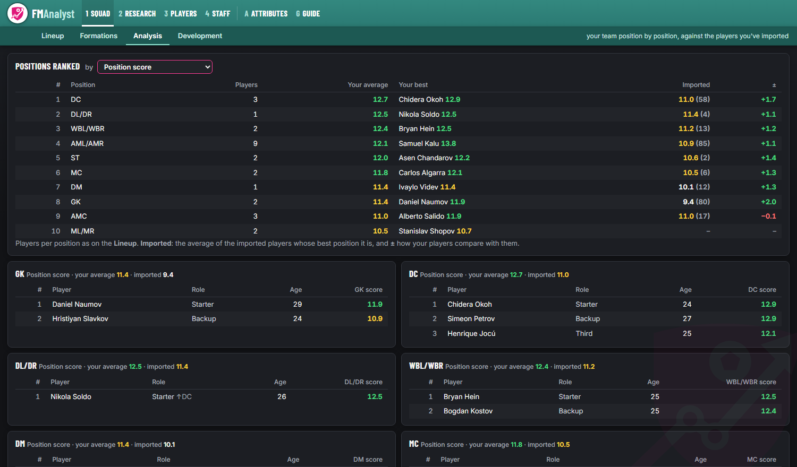
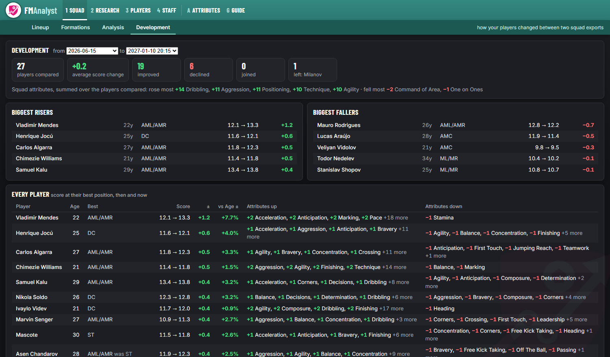
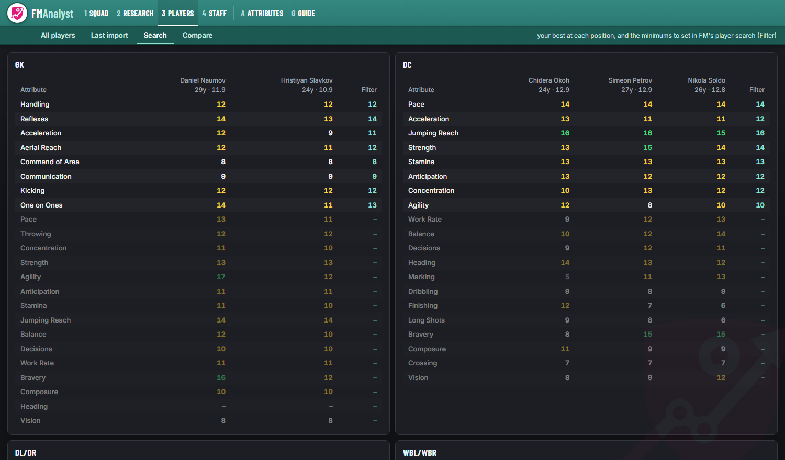

  

<h1 align="center">FMAnalyst</h1>

  <b>Squad, player and staff analysis for Football Manager 2027</b> 
  Every player you look at, scored at every position: plan your lineup, find better signings, hire better staff 
  and follow how your players develop.

  

  
  
  
  

  Press <b>F8</b> on a list in FM, choose <b>Menu → Import file…</b> in the app, and every page updates. 
  No typing, no screenshots. Everything is explained in the app's own <b>Guide</b> (key <b>G</b>).

---

  
   <b>Lineup</b>: your best eleven for any formation; click a position for everyone who plays it and who on your lists would beat them

<table>
  <tr>
    <td width="50%"> <b>Formations</b>: 20 shapes ranked by how well your squad fits them, each with its numbers</td>
    <td width="50%"> <b>Profiles</b>: what he's good for, strengths, weaknesses, what to train first</td>
  </tr>
  <tr>
    <td> <b>Compare</b>: two players side by side, at any position</td>
    <td> <b>Research</b>: your best at each position against everyone you've scouted, or your squad by age</td>
  </tr>
  <tr>
    <td> <b>Analysis</b>: your team position by position, ranked by score or any attribute</td>
    <td> <b>Development</b>: how your players changed between two squad exports</td>
  </tr>
  <tr>
    <td> <b>Player search</b>: the minimums to type into FM's search to beat your players</td>
    <td> <b>Staff</b>: every staff member scored for every job</td>
  </tr>
  <tr>
    <td colspan="2" align="center"> <b>Attributes</b>: one weight per attribute (1–20) for every save, to tune the scoring your way</td>
  </tr>
</table>

Screens from a demo save: your club and players will differ.

---

## Get started

About 15 minutes, once. Nothing here changes your FM saves.

### 1 · Add the F8 export to FM

FMAnalyst reads the lists that the free **[FM27 Exporter](https://github.com/v1adicke/fm27-exporter)** mod saves when you
press **F8** in FM (it isn't made by Sports Interactive or this project).

1. Quit FM. Open FM's game folder: in Steam, right-click **Football Manager 27** → **Manage → Browse local files**.
2. Download **`FM27Exporter-1.0.0.zip`** from [FM27 Exporter's releases](https://github.com/v1adicke/fm27-exporter/releases),
   extract it, and copy everything in its **`payload`** folder into FM's game folder. That installs BepInEx 6 and the
   exporter in one go.
3. Start FM (the first start takes a few minutes; a Windows note about `winhttp.dll` is fine).

Already have BepInEx 6, or F8 does nothing?

- With BepInEx 6 already installed, download **`FM27Exporter-1.0.0-plugin-only.zip`** instead and copy the exporter
  into **`BepInEx\plugins`**.
- If F8 does nothing: FM's game folder needs a `BepInEx` folder and `winhttp.dll`, and the exporter must be in
  `BepInEx\plugins`. `BepInEx\LogOutput.log` says whether it loaded.

In FM, **F8** exports the list under the mouse (every row), and **Ctrl + F8** adds all 47 attribute columns to the view.

### 2 · Get the app and set up your save

**[Download FMAnalyst.exe](https://github.com/angelkirchev/FMAnalyst/releases/latest/download/FMAnalyst.exe)**, put it
somewhere permanent (e.g. **Documents**) and double-click it. If Windows says *Windows protected your PC*, click
**More info → Run anyway** (it asks once).

The first time, it asks for the **club you manage** (exactly as FM writes it, e.g. "Man Utd"), the **currency** FM
shows wages in, and **FM27 Exporter's folder** (usually found for you). Click **Start**.

Or run it from source, with Python

Install [Python](https://www.python.org/downloads/) 3.11+ (tick **Add python.exe to PATH**), download this project
(green **Code** button → **Download ZIP**), extract it, and double-click **`FMAnalyst.bat`**. The first time it installs
pywebview, which the app needs.

### 3 · Add the views to FM

The views give FM's lists the columns the app reads.

1. **[Download the project ZIP](https://github.com/angelkirchev/FMAnalyst/archive/refs/heads/main.zip)** and extract it.
2. Quit FM and copy the files in its **`views`** folder into `Documents\Sports Interactive\Football Manager 27\views`
   (copy the files, not the folder; choose **Skip** if Windows asks about replacing your own).
3. In FM, use **`Squad - Outfield Players View`** on your squad, **`Search - Outfield Players View`** on player search
   and **`Search - Staff View`** on staff search. On each player view, press **Ctrl + F8** once so every attribute shows.

> **Tip:** add FM's **Position** column to your player views. Then a player's best position comes only from the
> positions FM says he plays, and wide players go to the side they play.

### 4 · Import your squad

On your squad screen in FM, point at the list and press **F8**. In the app, open **Menu → Import file…** (bottom right)
and choose the export. Done: your squad, lineup and formations are ready. Import searches, shortlists and staff the
same way whenever you're scouting.

---

<b>Good to know</b>

- **Your data** is in `Documents\FMAnalyst`. To update the app, replace `FMAnalyst.exe` with the newest one: your
  data stays.
- **Several saves:** **Menu → Saves** switches between them or starts a new one.
- **Players left out of an import** have too many unscouted attributes to score: scout them more and export again.
- **"The export has no attributes":** press **Ctrl + F8** on the list in FM, then **F8** again.
- **The window stays blank:** install Microsoft's **WebView2 Evergreen Runtime** from the
  [WebView2 page](https://developer.microsoft.com/microsoft-edge/webview2/).
- **Something else:** `app.log` in your data folder says what happened.

<b>Where the scores come from</b>

A position score is the weighted average of a player's attributes on FM's 1–20 scale. Each attribute has one weight
(1–20), multiplied at each position by FM's own CA cost there. The default weights come from **harvestgreen22**'s FM27
attribute test, measuring how much each attribute wins matches
([sortitoutsi](https://sortitoutsi.net/content/78219/fm27-attribute-test-tactical-understanding-training-system-preset-tactics-ai-reverse-engineering-engine-for-test#comment_910309),
tabled by squirrel_plays on [FM-Arena](https://fm-arena.com/threads/player-attributes.59/)), and the CA costs from
FM Scout's table. Change them on the **Attributes** page: one table for every save.

---

  Imports use <a href="https://github.com/v1adicke/fm27-exporter">FM27 Exporter</a> · MIT licence, see <a href="LICENSE">LICENSE</a> ·
  not affiliated with Sports Interactive or SEGA

